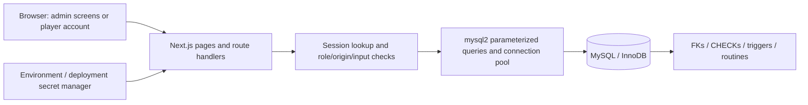
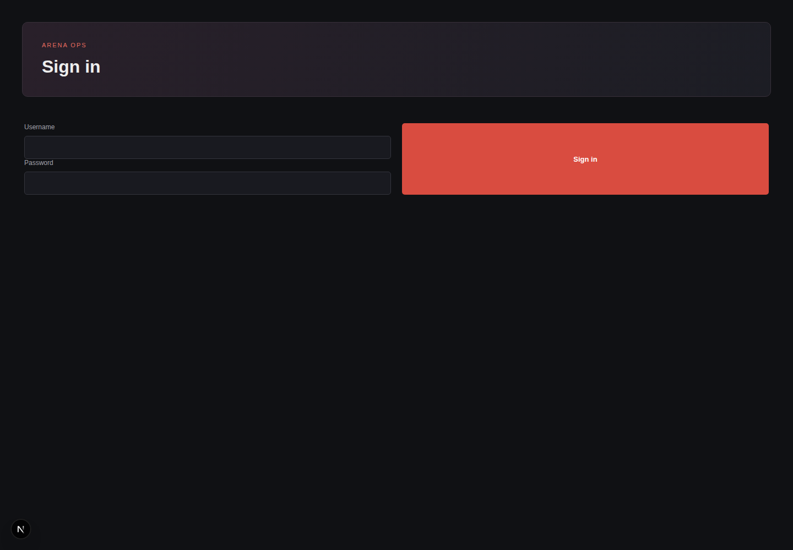
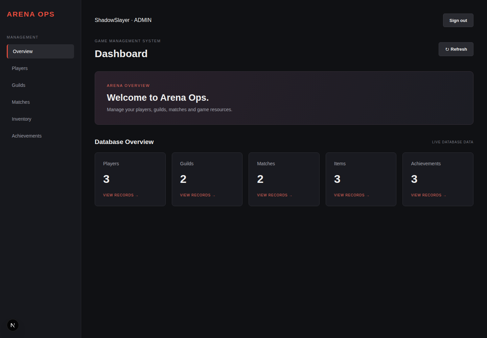
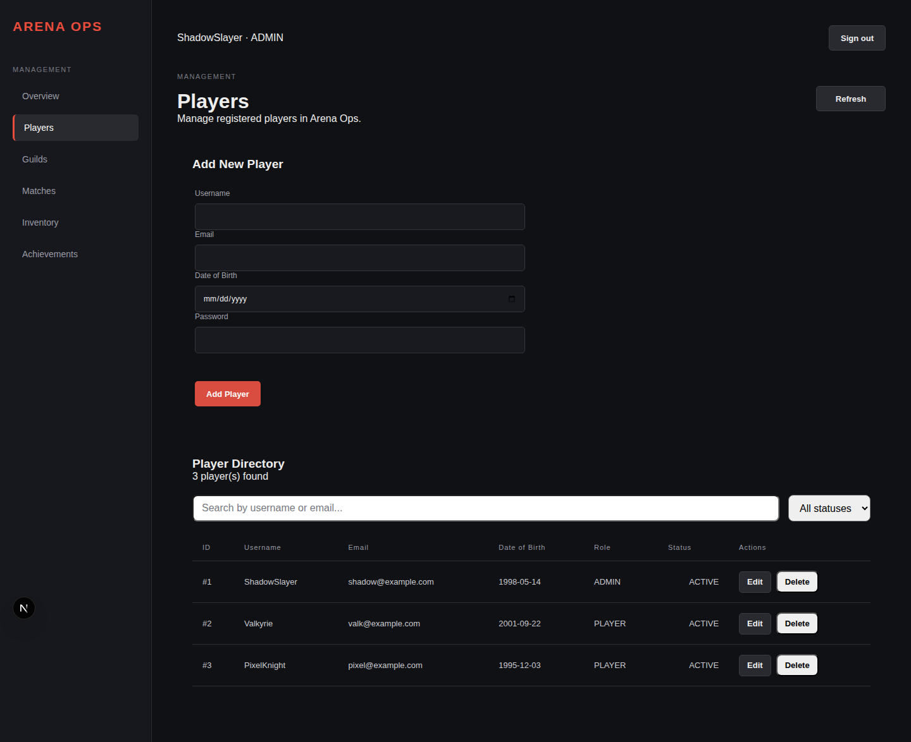
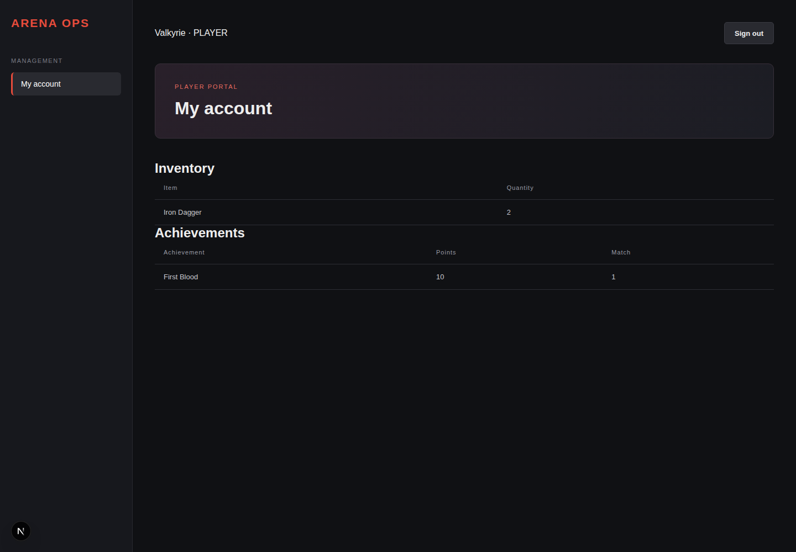

# Arena Ops — DBMS Level 3 project report

## Problem statement

A multiplayer arena needs consistent records of players, guild membership, match participation, inventory and earned achievements. Unrelated spreadsheets or unconstrained CRUD screens allow duplicate memberships, invalid awards, negative quantities and partial item transfers. Arena Ops uses relational constraints and transactions to keep these relationships coherent and role-based access to separate administration from player access.

## Objectives

1. Model game entities and many-to-many relationships with explicit keys and constraints.
2. Provide a Next.js interface for operational workflows and a personal player view.
3. Keep multi-step guild and inventory changes consistent when requests fail or compete.
4. Authenticate users, enforce two roles on the server, and protect passwords and credentials.
5. Demonstrate and test SQL joins, aggregation, subqueries, triggers, functions, indexing and transactions.

## Scope and functional requirements

| Area | Implemented behavior |
| --- | --- |
| Authentication | Username/password sign-in, eight-hour session, sign-out; active account and current role checked on every protected API call |
| Admin | Dashboard counts; player creation/edit/ban/delete; guild creation/leadership/edit/delete; item and inventory management; match participation/statistics/rounds; achievement definitions and awards |
| Player | Own inventory and earned achievements; account identity comes from the session, never a supplied player ID |
| Authorization | All management APIs require ADMIN; PLAYER and anonymous callers cannot mutate or read management records |
| Integrity | DB checks, unique keys, foreign keys, validation triggers, guild transactions and atomic inventory transfer procedure |
| Security | bcrypt cost 12; random session tokens stored as digests; same-origin mutations; bounded JSON; shared login throttle; generic errors; security headers; environment-based credentials |

Public signup, password recovery, MFA, self-service role changes, game simulation, payments, real-time gameplay and a NoSQL/vector component are outside the implemented scope. The second database paradigm required by course point 3 remains outstanding; this report does not claim full compliance with requirements outside 11–14.

## Database choice, model and implementation

MySQL/InnoDB fits structured relationships and operations that must succeed or fail together. Compound keys model inventory, participation, rounds and awards; referential constraints prevent orphaned records. DECIMAL stores economy values exactly. Constraints protect direct SQL writes as well as API requests.

See the [ER diagram, relational schema and full data dictionary](../mmo_database_design.md), [DDL](../mmo_database_ddl_mysql.sql), [sample data/routines](../mmo_dml.sql), [incremental migrations](../database/migrations), and [important queries](../database/important-queries.sql). There are 13 game tables and two application security tables. No document collections, embedding model, vector metric or semantic retrieval strategy exists in this version.

Advanced features are substantive: triggers validate birth dates and handle friendship ordering/match end time; a function computes player K/D; a stored procedure transfers items with a transaction, row lock and exception rollback; unique/FK/cleanup indexes support identity and relationships. Views are not currently used.

## System architecture

React pages request JSON from `/api`. Every management handler calls `RequireAdmin` before using the database. `/api/account` selects only the authenticated player's data. The UI shell redirects unauthenticated users to sign-in and players away from admin screens; API checks provide the actual security boundary. Unknown routes use Next.js not-found handling.

The login route compares bcrypt hashes, creates a random 256-bit token, and stores only its SHA-256 digest in MySQL. Its HttpOnly, SameSite=Lax cookie lasts eight hours and is Secure in production. A join checks account status, current role, expiration and the password-hash fingerprint, so password changes invalidate earlier sessions and bans block access. Logout deletes the current server-side session. Sign-in and sign-out start a fresh document so cached pages from the previous account are discarded.

All mutations require the configured same origin. Login allows ten attempts per normalized username per 15-minute window; existing usernames are canonicalized through the database result to prevent collation aliases bypassing the counter. Requests accept bounded JSON objects with primitive fields; HTML rendering uses React escaping and SQL values use bound parameters. The 16 KiB body limit applies to body-bearing create/update/login requests. API responses are no-store; CSP restricts framing, object content and base URLs. Production also uses HSTS. This is basic project hardening, not a complete deployment security assessment.

## Data consistency examples

- A guild is inserted with a temporarily NULL leader inside a transaction, then membership is inserted and the composite leader FK is assigned. Leader changes create membership before updating the leader pointer. Deletion clears the pointer and cascades memberships. No workflow disables foreign keys.
- Inventory transfer locks the sender row, validates the quantity, debits/deletes the source, credits the recipient and commits. Any SQL failure rolls back both sides. Call this procedure as a standalone transaction; it owns its transaction boundary. A deadlock rolls back and can be retried by the caller.
- An achievement cannot be awarded unless the player participated in that match. Duplicate unlocks are rejected by the compound PK.
- SQL DATE columns are returned as date-only strings, preserving birthdays without timezone shifts.
- Direct SQL with negative price/quantity, invalid subtype, malformed email or future birth date is rejected independently of browser validation.

## Application screenshots

Captured from the running application against disposable example data. The login password and cookies are not shown.

### Sign-in

### Admin overview

### Player management

### Player account

## Testing results

See [the testing record](testing.md) for reproducible commands, observed results and limitations. The tests exercise real MySQL and HTTP routes, not mocked database calls. Browser checks cover sign-in, logout and role navigation.

## Conclusion and future enhancements

Arena Ops connects a usable web interface to a relational model with enforced keys, validation and transaction boundaries. The work for requirements 11–14 adds verified role separation, database-level integrity, basic web/database security and documentation matching the actual code.

Future work: add a justified second database paradigm (for example document-based match event logs), password recovery/MFA, stronger deployment-wide abuse protection, audit records, pagination, broader concurrency/load tests, and resolution of the existing page lint errors. Restrict direct SQL operator access: a privileged operator can still create a guild with an unassigned leader, and bypassing application transactions is not a supported workflow. Existing sample password hashes must be replaced through controlled provisioning before any real deployment.
