# MMO Game Database — Design Document

Covers 34 entities across account/character management, world content, social systems,
economy, and progression. PostgreSQL-flavored, but portable to MySQL/MSSQL with minor tweaks.

---

## 1. ER Diagram

```mermaid
erDiagram
    SERVERS ||--o{ CHARACTERS : hosts
    SERVERS ||--o{ GUILDS : hosts
    SERVERS ||--o{ LOCATIONS : contains
    SERVERS ||--o{ MATCHES : hosts
    SERVERS ||--o{ LEADERBOARDS : scopes
    SERVERS ||--o{ EVENTS : hosts

    PLAYERS ||--o{ CHARACTERS : creates
    PLAYERS ||--o{ PURCHASES : makes
    PLAYERS ||--o{ SESSIONS : logs

    CHARACTERS }o--|| LOCATIONS : "current location"
    CHARACTERS }o--o| GUILDS : "member of"
    GUILDS ||--o{ GUILD_MEMBERSHIPS : has
    CHARACTERS ||--o{ GUILD_MEMBERSHIPS : joins
    GUILDS ||--o| CHARACTERS : "led by"

    LOCATIONS ||--o{ LOCATIONS : "sub-location of"
    LOCATIONS ||--o{ NPCS : contains
    FACTIONS ||--o{ NPCS : aligns

    NPCS ||--o{ QUESTS : gives
    LOCATIONS ||--o{ QUESTS : "set in"
    QUESTS ||--o{ QUEST_ITEM_REWARDS : rewards
    ITEMS ||--o{ QUEST_ITEM_REWARDS : "rewarded as"
    CHARACTERS ||--o{ CHARACTER_QUESTS : undertakes
    QUESTS ||--o{ CHARACTER_QUESTS : "attempted by"

    ITEMS ||--o| WEAPONS : specializes
    ITEMS ||--o| ARMOR : specializes
    CHARACTERS ||--o{ INVENTORY : holds
    ITEMS ||--o{ INVENTORY : "stored as"

    CHARACTERS ||--o{ PETS : owns

    SKILLS ||--o{ CHARACTER_SKILLS : "learned as"
    CHARACTERS ||--o{ CHARACTER_SKILLS : learns

    ACHIEVEMENTS ||--o{ CHARACTER_ACHIEVEMENTS : "unlocked as"
    CHARACTERS ||--o{ CHARACTER_ACHIEVEMENTS : earns

    MATCHES ||--o{ MATCH_PARTICIPANTS : includes
    CHARACTERS ||--o{ MATCH_PARTICIPANTS : competes

    CHARACTERS ||--o{ BATTLES : fights
    NPCS ||--o{ BATTLES : "fought against"
    LOCATIONS ||--o{ BATTLES : "occurs at"

    LEADERBOARDS ||--o{ LEADERBOARD_ENTRIES : ranks
    CHARACTERS ||--o{ LEADERBOARD_ENTRIES : "ranked in"

    CHARACTERS ||--o{ TRADES : initiates
    TRADES ||--o{ TRADE_ITEMS : contains
    ITEMS ||--o{ TRADE_ITEMS : "traded as"

    CHARACTERS ||--o{ AUCTIONS : sells
    ITEMS ||--o{ AUCTIONS : listed
    AUCTIONS ||--o{ AUCTION_BIDS : receives
    CHARACTERS ||--o{ AUCTION_BIDS : places

    CHARACTERS ||--o{ FRIENDS : "friends with"

    CHARACTERS ||--o{ MESSAGES : sends
    GUILDS ||--o{ MESSAGES : "guild chat"

    EVENTS ||--o{ EVENT_PARTICIPATION : "joined by"
    CHARACTERS ||--o{ EVENT_PARTICIPATION : participates

    ITEMS ||--o{ PURCHASES : "purchased as"
```



*(Attribute lists omitted from the diagram for readability — full attributes are in the
relational schema below.)*

---

## 2. Relational Schema

Notation: `Table(PK, attr, attr, FK → RefTable)`. Underlined-in-spirit PK is listed first.

```
servers(server_id, name, region, status, created_at)

players(player_id, username, email, password_hash, created_at, last_login, status, country)

locations(location_id, name, type, zone, min_level, coord_x, coord_y, coord_z,
          parent_location_id FK→locations, server_id FK→servers)

factions(faction_id, name, description, reputation_type)

characters(character_id, player_id FK→players, server_id FK→servers, name, class, race,
           level, experience, health, mana, gold, location_id FK→locations,
           guild_id FK→guilds, created_at, last_played_at, status)

guilds(guild_id, name, leader_character_id FK→characters, server_id FK→servers,
       level, description, created_at)

guild_memberships(membership_id, guild_id FK→guilds, character_id FK→characters,
                   role, joined_at)

npcs(npc_id, name, type, location_id FK→locations, faction_id FK→factions,
     level, is_hostile)

quests(quest_id, name, description, min_level, giver_npc_id FK→npcs,
       location_id FK→locations, reward_gold, reward_exp, quest_type)

quest_item_rewards(quest_id FK→quests, item_id FK→items, quantity)

character_quests(character_quest_id, character_id FK→characters, quest_id FK→quests,
                  status, started_at, completed_at)

items(item_id, name, description, item_type, rarity, level_requirement, base_value,
      max_stack, is_tradeable, is_sellable)

weapons(weapon_id, item_id FK→items, weapon_type, damage_min, damage_max,
        attack_speed, durability)

armor(armor_id, item_id FK→items, armor_type, defense, durability)

inventory(inventory_id, character_id FK→characters, item_id FK→items, quantity,
          slot_position, is_equipped, acquired_at)

pets(pet_id, character_id FK→characters, name, species, level, loyalty,
     is_active, acquired_at)

skills(skill_id, name, description, class_restriction, mana_cost, cooldown, base_damage)

character_skills(character_skill_id, character_id FK→characters, skill_id FK→skills,
                  skill_level, learned_at)

achievements(achievement_id, name, description, points, category)

character_achievements(character_achievement_id, character_id FK→characters,
                        achievement_id FK→achievements, unlocked_at)

matches(match_id, match_type, server_id FK→servers, started_at, ended_at,
        winner_character_id FK→characters, status)

match_participants(match_participant_id, match_id FK→matches, character_id FK→characters,
                    team, kills, deaths, assists, result)

battles(battle_id, character_id FK→characters, npc_id FK→npcs, location_id FK→locations,
        battle_type, started_at, ended_at, outcome, damage_dealt, damage_taken)

leaderboards(leaderboard_id, name, category, server_id FK→servers, period)

leaderboard_entries(leaderboard_entry_id, leaderboard_id FK→leaderboards,
                     character_id FK→characters, rank, score, recorded_at)

trades(trade_id, initiator_character_id FK→characters, recipient_character_id FK→characters,
       status, created_at, completed_at)

trade_items(trade_item_id, trade_id FK→trades, offering_character_id FK→characters,
            item_id FK→items, quantity, gold_offered)

auctions(auction_id, seller_character_id FK→characters, item_id FK→items, quantity,
         starting_price, buyout_price, current_bid,
         current_bidder_character_id FK→characters, start_time, end_time, status)

auction_bids(bid_id, auction_id FK→auctions, bidder_character_id FK→characters,
             bid_amount, bid_time)

friends(friendship_id, character_id_1 FK→characters, character_id_2 FK→characters,
        status, requested_at, accepted_at)

messages(message_id, sender_character_id FK→characters, recipient_character_id FK→characters,
         guild_id FK→guilds, content, message_type, sent_at, is_read)

events(event_id, name, description, event_type, start_time, end_time, server_id FK→servers)

event_participation(event_participation_id, event_id FK→events, character_id FK→characters,
                     score, joined_at, reward_claimed)

purchases(purchase_id, player_id FK→players, item_id FK→items, purchase_type,
          amount_usd, currency_received, transaction_id, purchased_at, payment_status)

sessions(session_id, player_id FK→players, character_id FK→characters,
         login_time, logout_time, ip_address)
```

### Key design notes
- **Weapons/armor** use table-per-subtype (1:1 with `items`) so any equippable item lives
  once in `items`, with type-specific stats split off — avoids a wide, mostly-null `items` table.
- **Guild ↔ Character** circularity (a guild has a leader who's a character; a character
  belongs to a guild) is resolved with a deferred FK — see DDL notes.
- **Battles vs Matches**: `matches` = structured PvP (arena/battleground, symmetric
  participants); `battles` = PvE encounters against an NPC (open-ended, one character-centric).
- **Friends** is a self-referencing pair on `characters`; enforce `character_id_1 < character_id_2`
  at the app layer (or a CHECK) to prevent duplicate mirrored rows.
- All monetary/currency fields use `NUMERIC` rather than `FLOAT` to avoid rounding drift.

---

## 3. DDL

Full CREATE TABLE statements are in **`mmo_database_ddl.sql`**.
